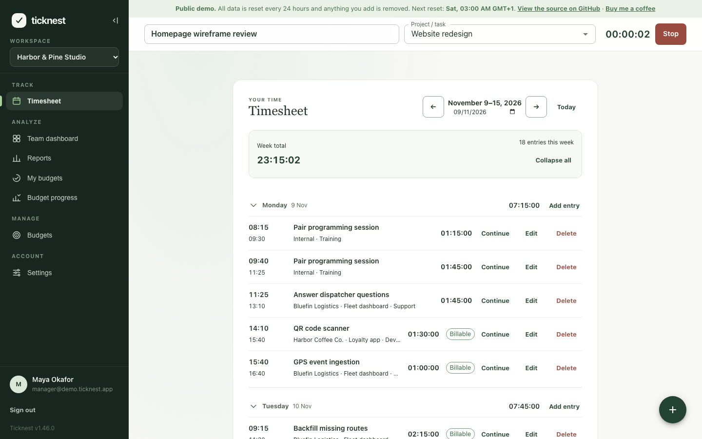
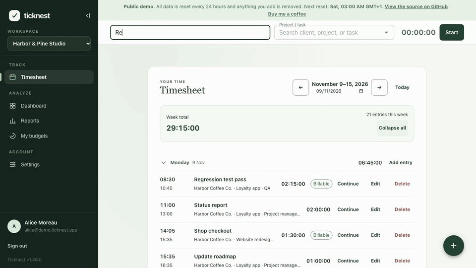
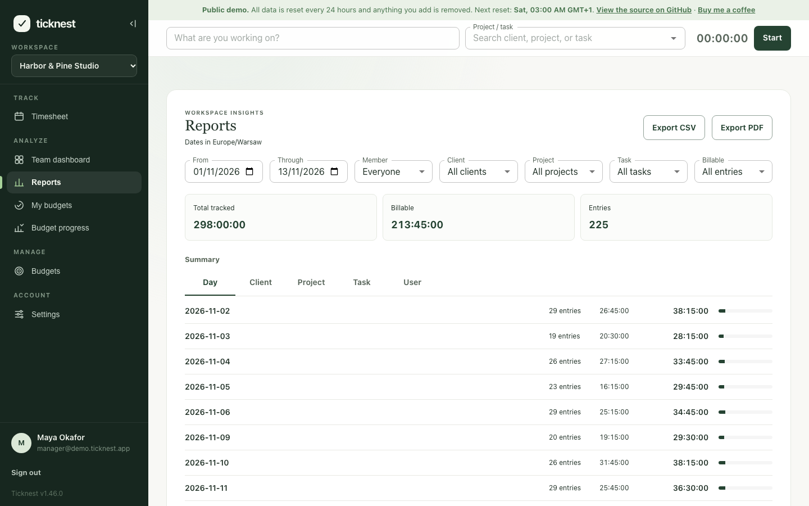
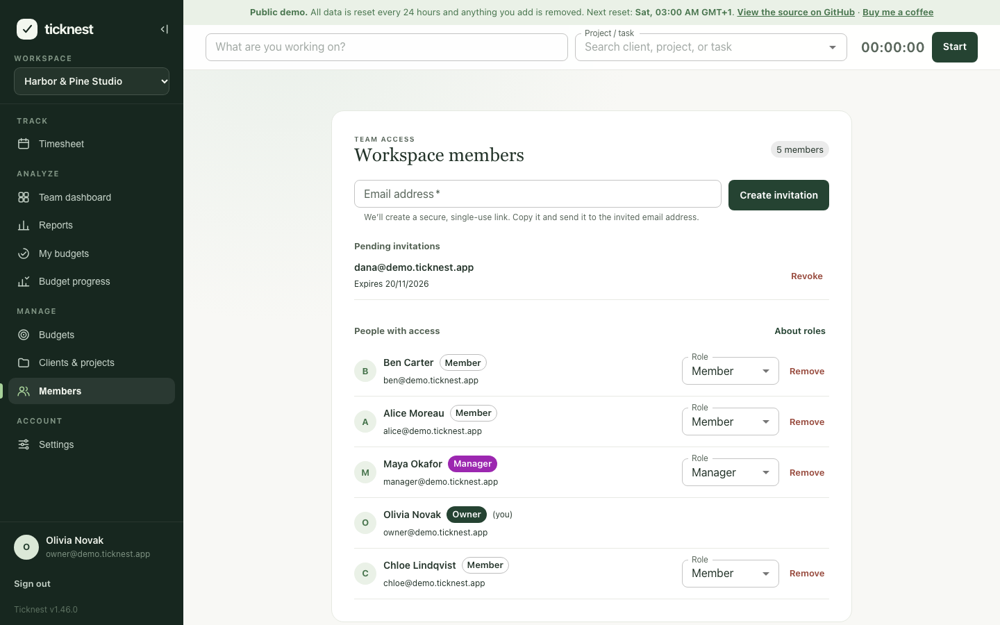
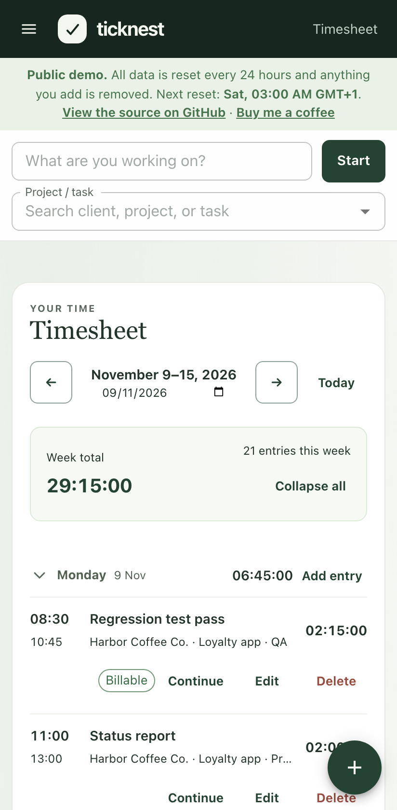
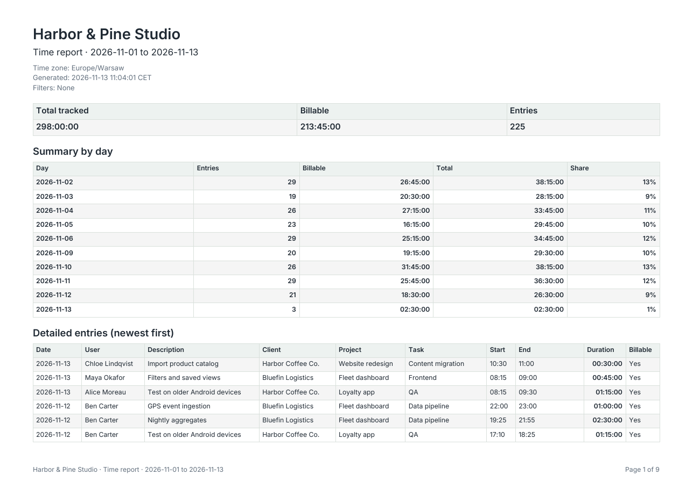

# Ticknest

[English](README.md) | **Español** | [Polski](README.pl.md)

**Control de horas de código abierto para equipos pequeños, que funciona en tu propio proyecto de Firebase.**

<picture>
  <source media="(prefers-color-scheme: dark)" srcset="docs/screenshots/en/timesheet-dark.png">
  
</picture>

| Registrar el tiempo                                                                | Informes y exportación                                                                       | Gestionar el equipo                                                                                                      |
| ---------------------------------------------------------------------------------- | -------------------------------------------------------------------------------------------- | ------------------------------------------------------------------------------------------------------------------------ |
|  |  |  |
|                  |        |                                                                                                                          |

Las capturas de pantalla están en inglés por ahora. Todas muestran los datos de la demo y se generan con `npm run screenshots`.

**[Prueba la demo](https://ticknest-pi.vercel.app)**: inicia sesión con una de las cuentas de ejemplo que aparecen en la pantalla de inicio de sesión. Los datos de la demo se restablecen cada 24 horas. La interfaz está disponible en español.

¿Primera vez por aquí? La **[página del proyecto](https://ticknest-landing.vercel.app)** (en inglés) resume qué hace Ticknest y en qué se diferencia de otras herramientas de control de horas.

La documentación completa está en inglés: consulta el [README](README.md) y la [guía de despliegue](docs/operations.md).

## Qué hace

- **Temporizador** siempre visible en la cabecera, con selección de proyecto y tarea. Los temporizadores en marcha se detienen solos a medianoche.
- **Hoja de horas** agrupada por día, con totales diarios y la opción de añadir entradas a mano.
- **Clientes, proyectos y tareas** en un catálogo con búsqueda y estimaciones en horas.
- **Informes** por día, cliente, proyecto, tarea o persona, con exportación a **CSV** y **PDF**.
- **Equipos**: invitaciones por enlace y los roles Propietario, Responsable y Miembro.
- **Presupuestos** (opcionales) para proyectos y personas.
- **Importación desde Clockify**: trae tu historial desde el CSV de un informe detallado, con una vista previa antes de guardar.
- **Interfaz en inglés, español y polaco**, paletas de colores claras y oscuras, y un diseño que funciona en teléfonos.

## Por qué Ticknest

- **Los datos son tuyos.** Todo se guarda en tu proyecto de Firebase; los autores no gestionan ningún servidor y no ven tus entradas.
- **Sin cuotas por usuario.** Solo pagas el consumo de Firebase.
- **Sin vigilancia.** Ni capturas de pantalla, ni seguimiento de actividad, ni analítica en la aplicación.
- **Código abierto** con licencia MIT.

## ¿Cuánto cuesta?

Para un equipo de 5 a 25 personas que registran su tiempo cada día laborable, **normalmente 0 $ al mes**: el consumo medido cabe en las cuotas gratuitas de Firebase (5 personas usan alrededor del 6 % de las lecturas diarias de Firestore; 25 personas, alrededor del 37 %). Aun así, Cloud Functions exige el plan Blaze y una cuenta de facturación, así que [configura una alerta de presupuesto](docs/operations.md#set-a-budget-alert). La [estimación medida](docs/operations.md#what-does-it-cost) (en inglés) detalla los supuestos, los precios para europe-west1 y us-central1 y la fecha de la medición. Es una estimación, no una garantía.

## Lo que (todavía) no hace

- No tiene integraciones con otras herramientas, API pública, aplicación móvil ni extensión de navegador. La aplicación web funciona en navegadores móviles.
- No tiene facturación ni tarifas por hora.

## Despliegue

El camino más corto: la aplicación web en Vercel y el backend (reglas de Firestore, índices y Functions) en Firebase. Los pasos están en la sección [Deploy](README.md#deploy) y los detalles, en la [guía de despliegue](docs/operations.md).

## Preguntas y ayuda

Puedes plantear preguntas, proponer ideas y enseñar tu propia instalación en [GitHub Discussions](https://github.com/kacper-szewczyk/Ticknest/discussions) (también en español), y avisar de errores abriendo una [incidencia (issue)](https://github.com/kacper-szewczyk/Ticknest/issues/new/choose). Las vulnerabilidades de seguridad se comunican en privado, como explica [SECURITY.md](SECURITY.md).

## Licencia

Ticknest se distribuye bajo la [licencia MIT](LICENSE).
