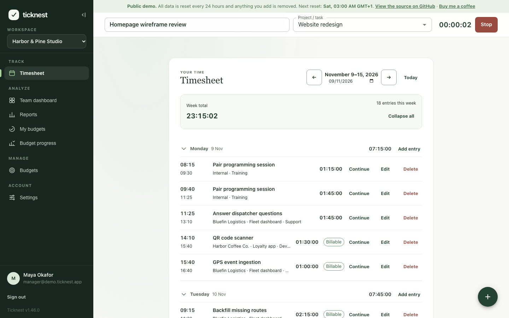
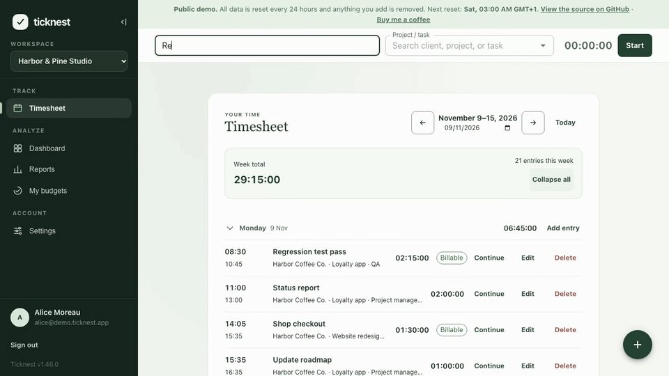
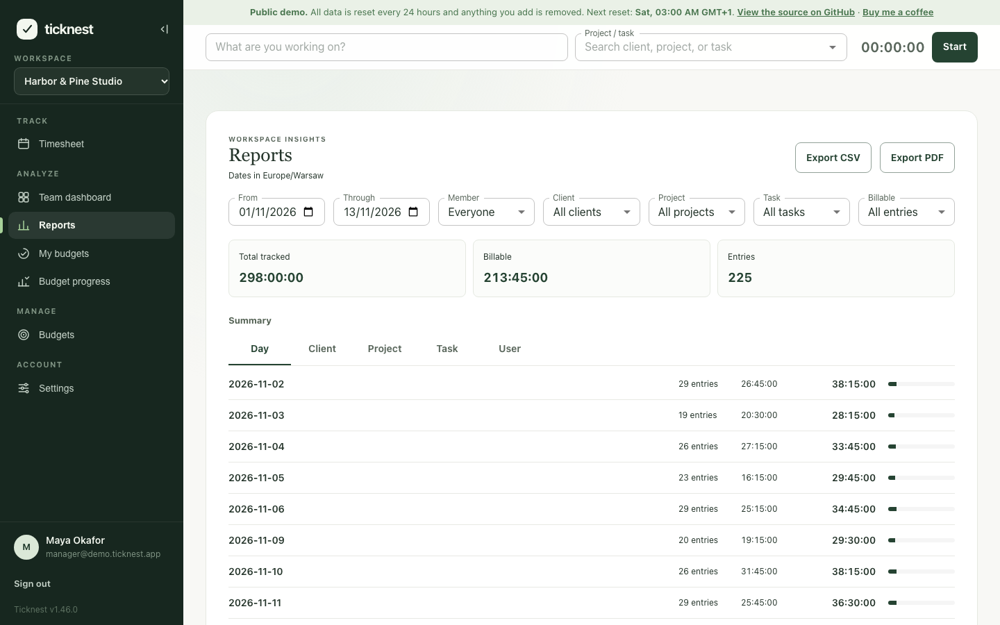
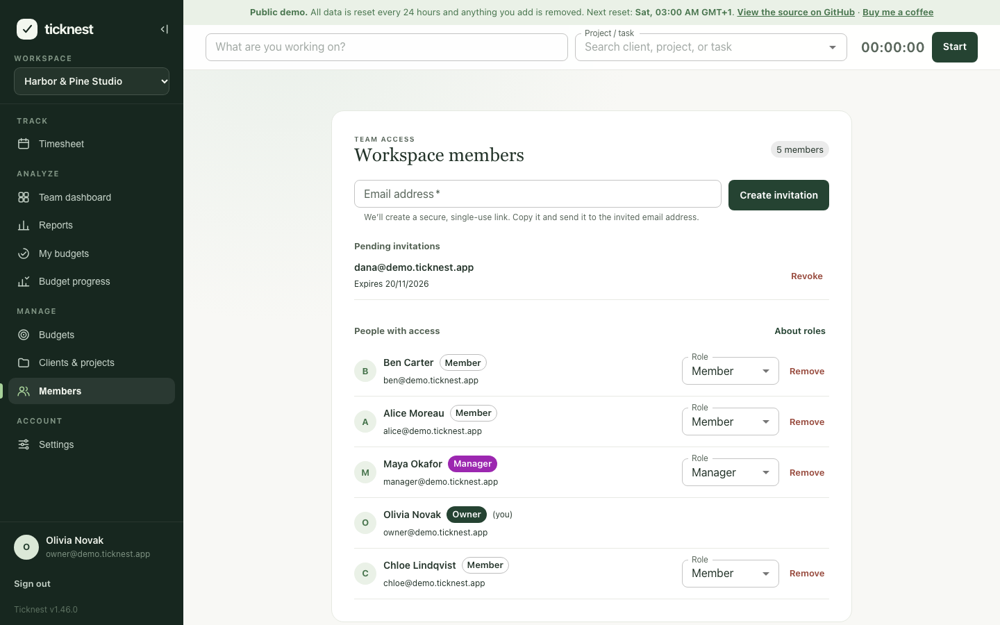
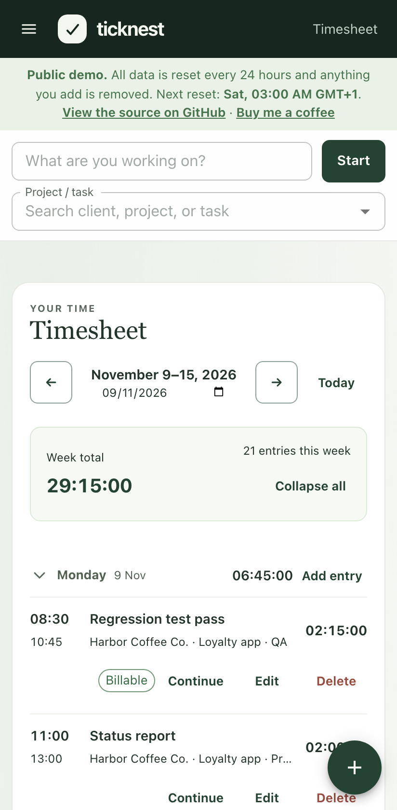
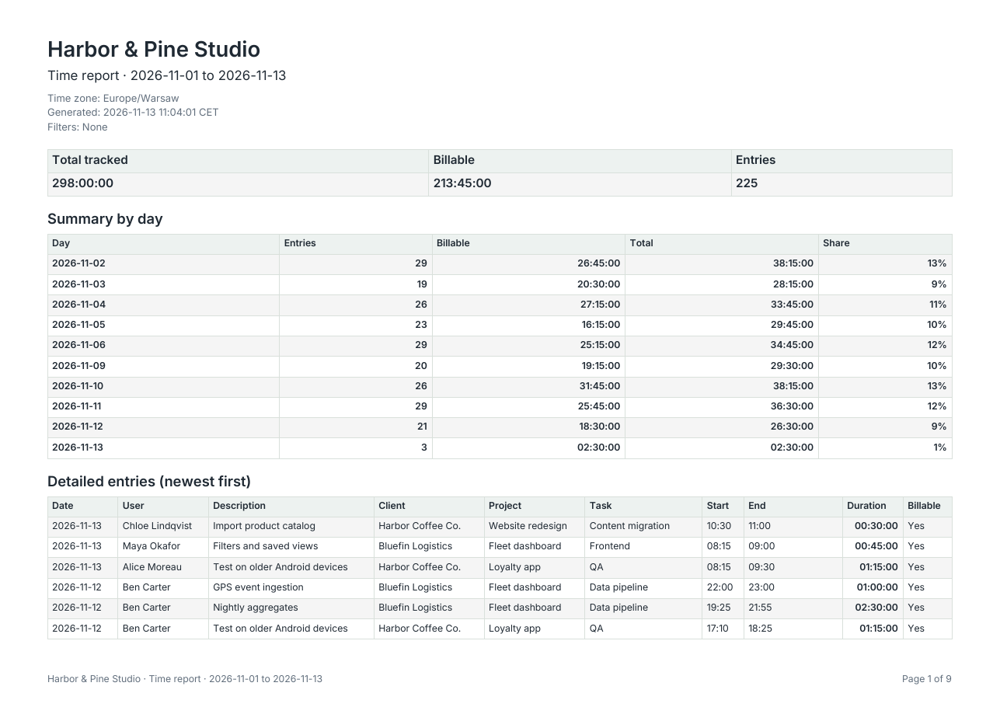

# Ticknest

**English** | [Polski](README.pl.md)

**Open-source time tracking for small teams, running in a Firebase project you own.**

[](LICENSE)
[](https://github.com/kacper-szewczyk/Ticknest/releases/latest)
[](https://github.com/kacper-szewczyk/Ticknest/actions/workflows/quality-checks.yml)
[](https://ticknest-pi.vercel.app)

<picture>
  <source media="(prefers-color-scheme: dark)" srcset="docs/screenshots/en/timesheet-dark.png">
  
</picture>

| Track time                                                                   | Report and export                                                                    | Manage the team                                                                                    |
| ---------------------------------------------------------------------------- | ------------------------------------------------------------------------------------ | -------------------------------------------------------------------------------------------------- |
|  |  |  |
|                   |     |                                                                                                    |

Screenshots in Polish are in [docs/screenshots/pl](docs/screenshots/pl). All of them show the demo data, regenerated with `npm run screenshots`.

**[Try the live demo](https://ticknest-pi.vercel.app)** with one of the sample accounts on the sign-in screen. Demo data resets every 24 hours.

New here? The **[landing page](https://ticknest-landing.vercel.app)** sums up what Ticknest does and how it compares with other time trackers.

## Features

- **Timer** always visible in the header. Start it with or without a description, pick a project and task from one search box, and running timers stop on their own at midnight.
- **Timesheet** grouped by day, with daily totals and a dialog for adding or editing entries after the fact.
- **Clients, projects and tasks** in a searchable catalog, with project colours, estimates in hours and tasks grouped by project.
- **Reports** grouped by day, client, project, task or user, with detailed entries on demand and export to **CSV** or **PDF** (generated in the browser).
- **Teams**: invite people by link, and give them the Owner, Manager or Member role. Managers see everyone's entries and reports; members see their own.
- **Budgets** (optional) for projects and people, with progress for members and a team overview for managers.
- **Workspaces** with their own name and week start, and a setup wizard for the first client, project and task.
- **Interface in English, Spanish and Polish**, light and dark colour palettes, and a layout that works on phones.

## Why not Clockify?

Ticknest covers the core of a hosted time tracker, with different trade-offs:

- **You own the data.** Everything lives in your own Firebase project. The maintainers run no backend and never see your entries.
- **No seat fees.** There are no per-user plans. You pay only Firebase's usage-based charges.
- **No monitoring.** No screenshots, activity tracking, keystroke or app logging, and no analytics or telemetry in the app. It records the time people enter, nothing else.
- **Open source** under the MIT licence, so you can read, change and audit all of it.

## What does it cost?

For a team of 5 to 25 people tracking time every workday, **usually $0 a month**: the measured usage stays within Firebase's no-cost quotas (5 people use about 6% of the daily Firestore reads, 25 people about 37%). Firebase still needs the Blaze plan and a billing account for Cloud Functions, so [set a budget alert](docs/operations.md#set-a-budget-alert). The [measured estimate](docs/operations.md#what-does-it-cost) gives the assumptions, prices for europe-west1 and us-central1, and the date it was measured. It is an estimate, not a guarantee.

## What Ticknest doesn't do (yet)

- No integrations with other tools (calendars, issue trackers, invoicing).
- No public API.
- No mobile app or browser extension. The web app works in mobile browsers.
- No invoicing or billable-rate calculations.

## Deploy

The shortest path to your own instance: host the web app on Vercel and keep the backend in Firebase.

1. Create a Firebase project on the Blaze plan, register a Web app, and enable Email/Password and Google sign-in.
2. Deploy the Firestore rules, indexes and Functions from a clone of this repository:

   ```sh
   npm install
   npm --prefix functions install
   npx firebase login
   npx firebase use --add
   npx firebase deploy --only firestore:rules,firestore:indexes,functions
   ```

3. Import the repository into [Vercel](https://vercel.com/new), add the `VITE_FIREBASE_*` values from your Web app as environment variables, and deploy.
4. Add the Vercel domain to the authorised domains under Authentication → Settings in the Firebase console.

The **[full setup guide](docs/operations.md)** covers each step in detail, plus deploying entirely to Firebase Hosting, deploying from GitHub Actions, demo mode, App Check, security headers, backups and teardown.

## Quick start

Run Ticknest locally against the Firebase emulators.

Requirements: Node.js 22.12+, 24.x, or 26.x, npm, and Java JDK 11+ for the Firebase emulators.

```sh
npm install
cp .env.example .env.local
npm --prefix functions install
npm run emulators
```

In another terminal, run `npm run dev` and open <http://127.0.0.1:5173>.

## Support and contact

**Questions, ideas or something to show?** Join [GitHub Discussions](https://github.com/kacper-szewczyk/Ticknest/discussions): ask in [Q&A](https://github.com/kacper-szewczyk/Ticknest/discussions/categories/q-a), suggest features in [Ideas](https://github.com/kacper-szewczyk/Ticknest/discussions/categories/ideas), or share your setup in [Show and tell](https://github.com/kacper-szewczyk/Ticknest/discussions/categories/show-and-tell). Found a bug? [Open an issue](https://github.com/kacper-szewczyk/Ticknest/issues/new/choose). Contributions are welcome: issues labelled [good first issue](https://github.com/kacper-szewczyk/Ticknest/labels/good%20first%20issue) and [help wanted](https://github.com/kacper-szewczyk/Ticknest/labels/help%20wanted) are a good place to start, and [CONTRIBUTING.md](CONTRIBUTING.md) explains how.

> [!TIP]
> **Enjoying Ticknest?** Buying me a coffee helps keep the project maintained and the public demo online.
>
> [](https://buymeacoffee.com/kszewczyk)

**Need help with setup or a custom feature?** Get in touch:

[](mailto:kacper.szewczyk.sp@gmail.com)
[](https://www.linkedin.com/in/kacperszewczyk)

## Documentation

- [Full setup guide: self-hosting, deployment, privacy, costs, backups, and teardown](docs/operations.md)
- [Running a public demo](docs/operations.md#demo-mode-optional)
- [Contributing](CONTRIBUTING.md)
- [Security policy and reporting vulnerabilities](SECURITY.md)
- [Coding standards](CODING_STANDARDS.md)
- [Firestore data model](docs/firestore-data-model.md)
- [Firestore rules test matrix](docs/firestore-rules-test-matrix.md)

## License

Ticknest is distributed under the [MIT License](LICENSE).
