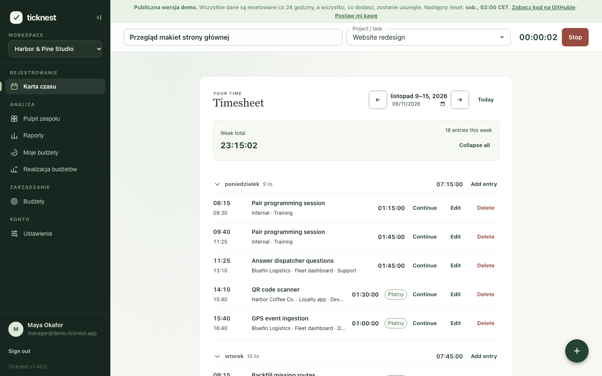
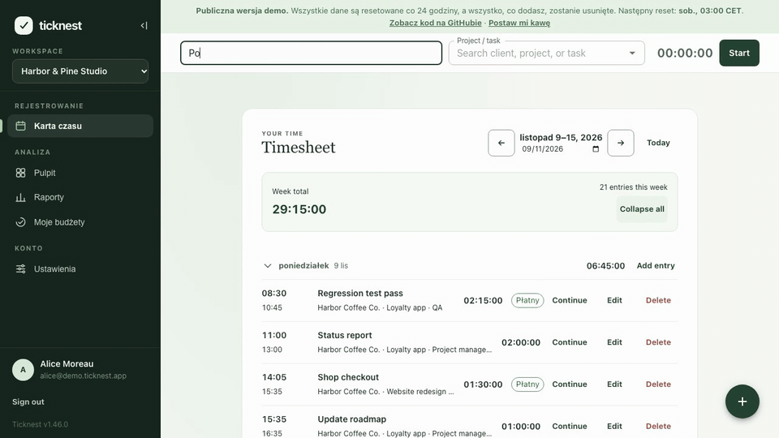
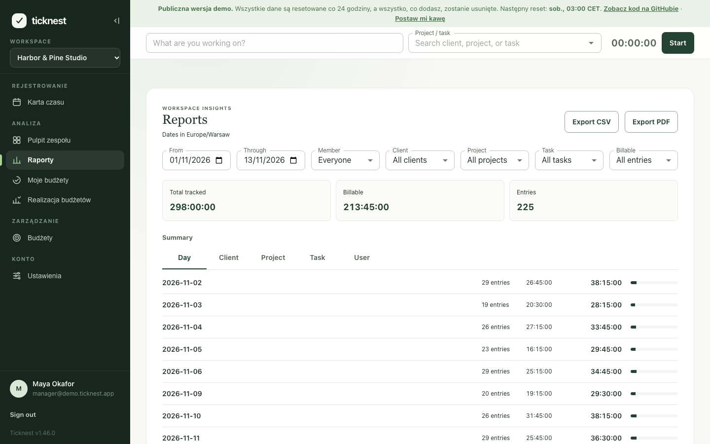
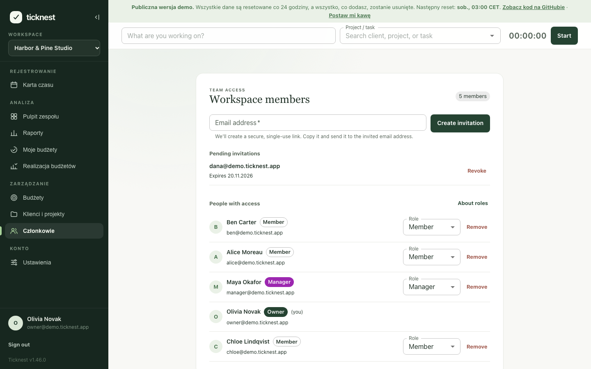
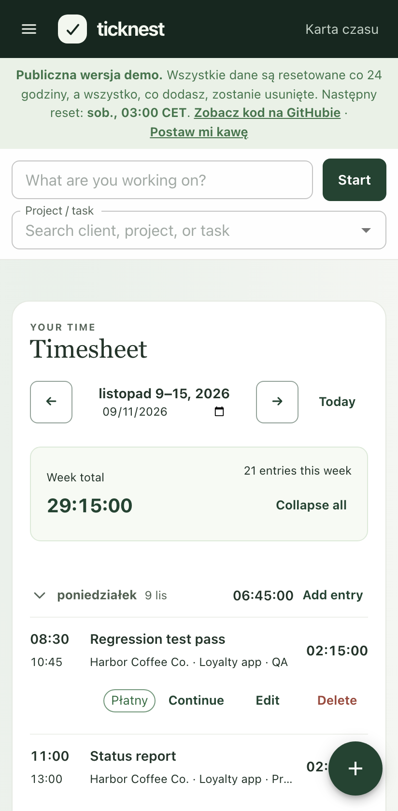
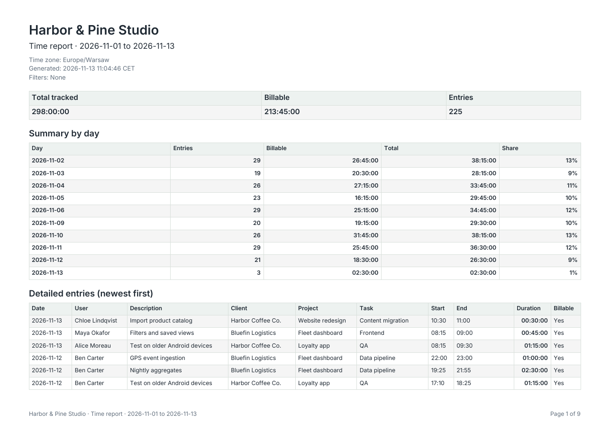

# Ticknest

[English](README.md) | **Polski**

**Otwartoźródłowy system do śledzenia czasu pracy dla małych zespołów, działający w Twoim własnym projekcie Firebase.**

<picture>
  <source media="(prefers-color-scheme: dark)" srcset="docs/screenshots/pl/timesheet-dark.png">
  
</picture>

| Mierzenie czasu                                                                            | Raporty i eksport                                                                      | Zarządzanie zespołem                                                                                        |
| ------------------------------------------------------------------------------------------ | -------------------------------------------------------------------------------------- | ----------------------------------------------------------------------------------------------------------- |
|  |    |  |
|                                 |  |                                                                                                             |

Wszystkie zrzuty ekranu pokazują dane demo i są generowane poleceniem `npm run screenshots`.

**[Wypróbuj demo](https://ticknest-pi.vercel.app)**: zaloguj się jednym z przykładowych kont pokazanych na ekranie logowania. Dane demo są resetowane co 24 godziny. Interfejs jest dostępny po polsku.

Pełna dokumentacja jest po angielsku: zobacz [README](README.md) i [przewodnik wdrożenia](docs/operations.md).

## Co potrafi

- **Timer** zawsze widoczny w nagłówku, z wyborem projektu i zadania. Uruchomione timery zatrzymują się same o północy.
- **Karta czasu pracy** pogrupowana po dniach, z dziennymi sumami i ręcznym dodawaniem wpisów.
- **Klienci, projekty i zadania** w katalogu z wyszukiwaniem i szacunkami w godzinach.
- **Raporty** według dnia, klienta, projektu, zadania lub osoby, z eksportem do **CSV** i **PDF**.
- **Zespoły**: zaproszenia przez link i role Właściciel, Menedżer i Członek.
- **Budżety** (opcjonalne) dla projektów i osób.
- **Interfejs po angielsku, hiszpańsku i polsku**, jasne i ciemne palety kolorów, działa na telefonach.

## Dlaczego Ticknest

- **Dane należą do Ciebie.** Wszystko jest w Twoim projekcie Firebase; autorzy nie prowadzą żadnego serwera i nie widzą Twoich wpisów.
- **Bez opłat za użytkownika.** Płacisz tylko za zużycie Firebase, które dla małego zespołu często mieści się w darmowym limicie.
- **Bez monitorowania.** Żadnych zrzutów ekranu, śledzenia aktywności ani analityki w aplikacji.
- **Otwarty kod** na licencji MIT.

## Czego (jeszcze) nie ma

- Integracji z innymi narzędziami, publicznego API, aplikacji mobilnej ani rozszerzenia przeglądarki. Aplikacja webowa działa w przeglądarkach mobilnych.
- Fakturowania i stawek godzinowych.

## Wdrożenie

Najkrótsza droga: aplikacja webowa na Vercel, backend (reguły Firestore, indeksy, Functions) w Firebase. Kroki opisuje sekcja [Deploy](README.md#deploy), a szczegóły [przewodnik wdrożenia](docs/operations.md).

## Licencja

Ticknest jest udostępniany na [licencji MIT](LICENSE).
